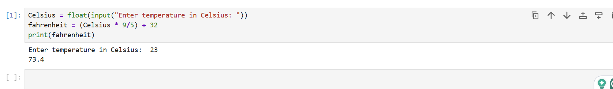

# Python Fundamentals: Temperature Converter
This project is a simple command-line script that converts Celsius temperatures to Fahrenheit.
## Files included
* temperature_converter.py 
* Screenshot.png
## How to run the script
Navigate to the command prompt and run the command: python temperature_converter.py
Open the appropriate folder and enter the temperature reading you wish to convert.
## Manual Testing
I tested the code and validated the response. I ran the code in Jupyter Notebook and watched it prompt me for a Celsius temperature to convert. I entered it and watched 
it convert my response into a Fahrenheit temperature.
## Verification
.
## My assumptions
I thought that I would be able to enter the code into Jupyter Notebook and have it run almost exactly as it was written in the instructions. I forgot that it needed parameters, the float. I needed help understanding how to input that into the code, so I received assistance from Google Gemini and from GeeksforGeeks. (2025). Python Program to Convert Celsius to Fahrenheit. geeksforgeeks.org, although their formula was written differently, to understand the sequence required for the parameters. The code worked but did not meet the requirements for the assignment. Gemini AI helped me understand and write these parameters into the code, i.e.: the try/except, safety nets, and string token splitting.
